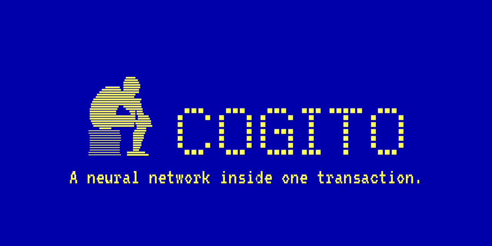
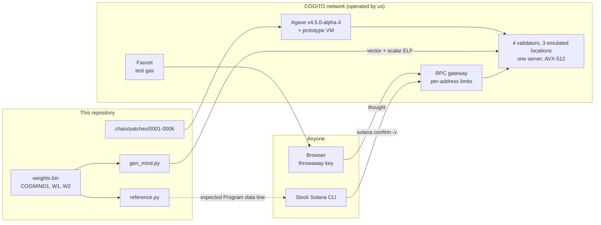
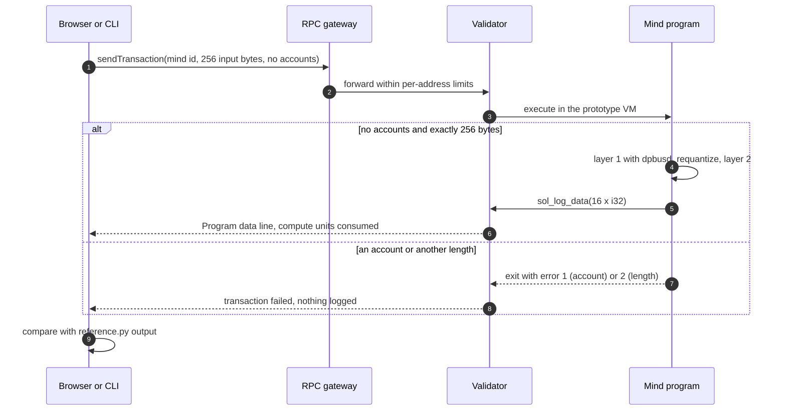
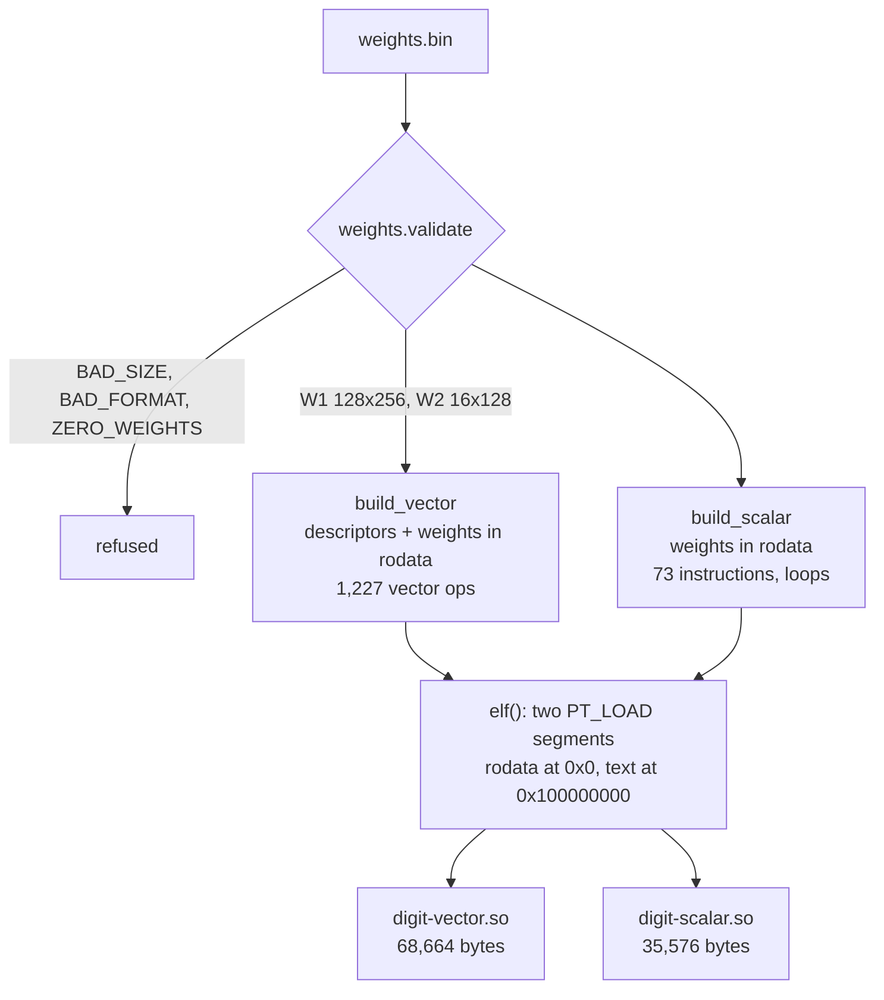
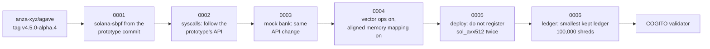

<p align="center"></p>

# COGITO

**A small neural network that runs inside one transaction, on a Solana-compatible chain whose VM has 512-bit vector instructions.**

The digit network answers for 1,700 CU in its vector program, and the whole transaction, as the site sends it with its compute-budget instruction, costs 1,850 CU. The same network on today's instruction set costs 349,958 CU. Read a fresh thought yourself with the stock Solana CLI: `solana confirm -v <signature> --url https://rpc.cogito.run`.

<p align="center">
<a href="#license"></a>
<a href="docs/whitepaper.md"></a>
<a href="https://www.python.org/downloads/release/python-3123/"></a>
<a href="https://github.com/cogitochain/cogito/actions/workflows/ci.yml"></a>
<a href="VERIFY.md"></a>
<a href="https://cogito.run"></a>
<a href="https://x.com/cogitochain"></a>
</p>

Website [https://cogito.run](https://cogito.run) · X [https://x.com/cogitochain](https://x.com/cogitochain) · GitHub [https://github.com/cogitochain/cogito](https://github.com/cogitochain/cogito) · Whitepaper [docs/whitepaper.md](docs/whitepaper.md)

## Overview

COGITO is a Solana-compatible chain we run ourselves. It is not Solana mainnet: it is Agave `v4.5.0-alpha.4` with six patch files: five replace the SBPF virtual machine with the prototype of the SIMD-0714 draft (temporalxyz/sbpf, commit `585f893`) and switch its vector instructions on, and one lowers the smallest ledger a node may keep, so our nodes hold a short window of history. With them, an Int8 network with 256 inputs, 128 hidden units and 16 outputs answers inside a single transaction for 1,700 CU, where the same network on today's instruction set costs 349,958 CU. SIMD-0714 is a draft and has not been adopted; we are not among its authors. We ran its prototype as it is and measured it.

No key can change a mind once it is on the network. Every mind is deployed final, with no upgrade authority, and its program refuses any account: a thought reads 256 bytes of instruction data and writes one log line, so it has nothing it could move. The network's gas is test gas from a faucet, with no value. The programs run independently of the $COGITO token.

This repository holds what anyone needs to check the programs without trusting us: the six patch files and the command that applies them, the generator that writes each mind as an SBPF v3 program in two forms (vector and a scalar twin) from a weights file, the reference computation that predicts the exact `Program data:` line every thought must log, the digit mind's weights with its training script and measured accuracy, the prototype VM harness behind the wall-time figures, and the whitepaper source. Everything here builds and tests without a chain: 91 passing, recorded in [VERIFY.md](VERIFY.md). It does not hold our measuring scripts (`rig.py`, the per-mind and largest-mind measurements) or the network's own scripts (slot pace, confirm times, load); the whitepaper's chain rows were measured with them on our network. Any thought on that network can still be read with the stock CLI.

## How it works

1. **Train.** `chain/minds/digit/train.py` trains the digit mind on MNIST brought to 16 x 16, with the programs' exact integer arithmetic in the forward pass, and writes `weights.bin`.
2. **Pack.** A mind is one 34,824-byte file: the magic `COGMIND1`, then W1 (128 x 256 signed bytes) and W2 (16 x 128), row-major. `weights.py` validates it and refuses a wrong size, a wrong header or an all-zero layer.
3. **Generate.** `gen_mind.py` writes two SBPF v3 ELF files from the same weights: the vector program, where each operation is `lddw r1, <descriptor>` and `call sol_avx512`, and the scalar twin on today's instruction set.
4. **Deploy.** Both programs are deployed final with the fork's own CLI, the only one that can deploy SBPF v3 today. Neither has an upgrade authority.
5. **Think.** A thought is one transaction to a mind with the 256 input bytes as instruction data and no accounts. The program computes h = clamp(relu(W1 x) >> 8, 0, 255) and y = W2 h and logs y as sixteen little-endian i32 values with one `sol_log_data` call.
6. **Check.** `reference.py` recomputes y off chain from the same weights and prints the `Program data:` line the chain must log; the stock Solana CLI shows the real one with `solana confirm -v <signature> --url https://rpc.cogito.run`. The node keeps only the newest few hours of transactions (about 3 hours on the main RPC node; see the whitepaper's limits), so check a fresh thought: an older signature answers "not found". The site keeps its own record of each thought (slot, compute units, answer, time).

## Architecture



The patches turn upstream Agave into the node every validator runs; the generator turns a weights file into the two programs those validators execute. The reference computation never touches the network: it predicts, byte for byte, what the network will log, so anyone can compare a real transaction's log with it.



One thought is one instruction. A thought with an account or with any length other than 256 bytes ends with a custom error before a single weight is read. The tests run both refusals on both programs in `tests/sbpf.py`; the vector program refuses before its first vector operation, which is why the small interpreter can run it that far.



The generator is deterministic: the same weights give the same bytes. A test holds the digit mind's programs built from this repository to the SHA-256 below, and the programs deployed on the network have the same SHA-256:

| Program | Address on the COGITO network | SHA-256 |
|---|---|---|
| Digit mind, vector | `2HvJc3DgxJKvid4JeAgBPMY2L9ArBRJyuAFfL412DG92` | `3d9120c51924f2a4b7bca64ebdcbf4044058ede9e30cb49f7d11f4e599d793f2` |
| Digit mind, scalar twin | `6R5qzU3v9uarrmX4rbnejFjvTmNwK9zx3FPcBqqFGQV1` | `17665f6dbbd8c3d1d4ea6b4a52e7ab5e7e7a3567f300065aac26692cde735991` |

Compare them yourself with the stock CLI:

```
solana program dump 2HvJc3DgxJKvid4JeAgBPMY2L9ArBRJyuAFfL412DG92 deployed-vector.so --url https://rpc.cogito.run
solana program dump 6R5qzU3v9uarrmX4rbnejFjvTmNwK9zx3FPcBqqFGQV1 deployed-scalar.so --url https://rpc.cogito.run
sha256sum deployed-vector.so out/digit-vector.so deployed-scalar.so out/digit-scalar.so
```



The base is Agave tag `v4.5.0-alpha.4` (commit `ccddd3dffc7edb1d6ed8182ac8e9cbd73b24b159`), and 0001 points `solana-sbpf` at temporalxyz/sbpf commit `585f8935f10863b31ce5fc5676aa16879a8eb1ee`. Each patch is one change to one file, in order, applied with `git apply` by `bash chain/patches/apply.sh <agave checkout>`. Nothing else in Agave changes; the node's fee schedule, consensus and runtime are upstream's, and the vector instructions are priced by the prototype's own CU schedule.

### Programs and accounts

A mind has no state account. Everything it needs is in its own program: the code in the text segment, the weights and the vector descriptors in read-only data.

- **Mind program, vector** (deployed final): the vector code, 59 descriptors (944 bytes) and 34,816 weight bytes.
- **Mind program, scalar twin** (deployed final): the scalar loops and the same 34,816 weight bytes.
- **Fee payer of a thought**: test gas from the faucet; the browser uses a throwaway key.

No account is derived from seeds.

## Repository structure

```
.
├── chain
│   ├── patches
│   │   ├── 0001-sbpf-prototype.patch               solana-sbpf from the prototype commit
│   │   ├── 0002-api-drift-syscalls.patch           aligned_region_size replaces a removed flag
│   │   ├── 0003-api-drift-mock-bank.patch          the same change in the SVM test bank
│   │   ├── 0004-vector-ops-aligned-mapping.patch   vector ops and the aligned mapping they need
│   │   ├── 0005-deploy-skip-duplicate-avx512.patch the deploy environment registers sol_avx512 once
│   │   ├── 0006-ledger-floor.patch                 smallest kept ledger 50,000,000 -> 100,000 shreds
│   │   └── apply.sh                                applies the stack in order
│   └── minds
│       ├── weights.py           the COGMIND1 format: validate, pack, hash, seeded random weights
│       ├── reference.py         the exact integer forward pass and the Program data line
│       ├── gen_mind.py          SBPF v3 assembler, vector and scalar code generation, ELF writer
│       ├── fetch_mnist.sh       MNIST download checked against its SHA-256 sums
│       ├── digit
│       │   ├── train.py         training with the programs' arithmetic in the forward pass
│       │   ├── preprocess.py    ink image to the 256 input bytes
│       │   ├── accuracy.py      accuracy on the 10,000 held-out MNIST digits
│       │   ├── weights.bin      the digit mind
│       │   ├── train-log.json   seed, schedule, loss per epoch, weights hash
│       │   └── op-counts.json   static op counts of both programs
│       ├── fixtures
│       │   ├── inputs.json      12 inputs with their outputs and answers
│       │   ├── inputs.bin       the same inputs, 256 bytes each
│       │   └── make_fixtures.py how they were made
│       ├── tools
│       │   ├── pack_weights.py  JSON matrices to a weights file
│       │   └── op_counts.py     counts what the generator emits
│       └── vm
│           ├── mind_vm.rs       harness run inside the prototype VM crate
│           ├── build.sh         places and builds the harness
│           ├── check.py         both programs, JIT and interpreter, against the reference
│           └── bench.sh         p50 wall time of one program
├── docs/whitepaper.md           the whitepaper source, with every measured figure
└── tests                        unittest suites and a small SBPF interpreter for the scalar twin
```

Today's compilers emit neither the vector instructions nor the prototype's SBPF v3 layout, so `gen_mind.py` assembles every instruction itself: a vector operation is a 16-byte descriptor in read-only data (operation, immediate, output and input registers, offset) loaded with `lddw r1` and executed by `call sol_avx512`. Layer 1 runs as `ldbc.d` (broadcast four input bytes), `ld` (64 bytes of weights) and `dpbusd` (64 multiply-adds), sixteen hidden units at a time.

`reference.py` is the other half: the same arithmetic in Python, used by the tests, by the VM check and by anyone comparing a transaction log. `tests/sbpf.py` executes the scalar twin instruction by instruction; it counts 349,694 instructions for the first fixture, and the network charges that thought 349,958 CU, the difference being the 264 CU of the logging call.

## Quick start

Requirements: Python 3.12.3 with numpy 2.5.4 and Pillow 13.0.0 (`requirements.txt`), git 2.43 or newer. For the VM check: Rust (the prototype crate selects stable; rustc 1.100.0 in our runs) and an x86-64 CPU with AVX-512.

```
python3 -m pip install -r requirements.txt
mkdir -p out
python3 chain/minds/gen_mind.py elf-vector chain/minds/digit/weights.bin out/digit-vector.so
python3 chain/minds/gen_mind.py elf-scalar chain/minds/digit/weights.bin out/digit-scalar.so
python3 -m unittest discover -s tests -v
```

The patch stack against Agave at the tag:

```
git clone --depth 1 --branch v4.5.0-alpha.4 https://github.com/anza-xyz/agave agave
bash chain/patches/apply.sh agave
```

Both programs in the prototype VM, JIT and interpreter, on the twelve fixtures (`sbpf` is a checkout of temporalxyz/sbpf at `585f8935f10863b31ce5fc5676aa16879a8eb1ee`):

```
cd sbpf && cargo build --release && cd ..
bash chain/minds/vm/build.sh sbpf sbpf
python3 chain/minds/vm/check.py sbpf out/digit-vector.so out/digit-scalar.so chain/minds/fixtures/inputs.bin --weights chain/minds/digit/weights.bin
```

Together these are 91 passing: 37 unit tests, the six patches, and 48 VM runs (12 inputs, 2 programs, JIT and interpreter) whose logged outputs equal the reference. [VERIFY.md](VERIFY.md) records the run. CI runs the unit tests and patch checks on pushes to main and on pull requests. The VM execution steps run when the runner supports AVX-512.

To compare the reference log with an on-chain result, use a recent transaction that ran the same digit program on the same 256 input bytes. This example uses the first fixture.

```
head -c 256 chain/minds/fixtures/inputs.bin > out/first-input.bin
python3 chain/minds/reference.py chain/minds/digit/weights.bin out/first-input.bin
read -r -p "Transaction signature for this input: " SIGNATURE
solana confirm -v "$SIGNATURE" --url https://rpc.cogito.run
```

Use the reference from Python:

```python
import sys
sys.path.insert(0, "chain/minds")
from weights import load_weights
from reference import forward, log_data

w1, w2 = load_weights("chain/minds/digit/weights.bin")
x = list(open("chain/minds/fixtures/inputs.bin", "rb").read()[:256])
h, y = forward(w1, w2, x)
print(max(range(10), key=lambda k: (y[k], -k)), "Program data: " + log_data(y))
```

Reproduce the accuracy figure (downloads MNIST, about 11 MB, and checks its SHA-256 sums):

```
bash chain/minds/fetch_mnist.sh
python3 chain/minds/digit/accuracy.py chain/minds/data chain/minds/digit/weights.bin
```

### Measured

From the whitepaper's measured rows. Host: one virtual machine with 28 virtual CPUs on an AMD Ryzen 9 9950X (a 16-core processor with AVX-512). Chain rows: our network of 4 validators in 3 emulated locations, all four on that one server. Wall-time rows: the prototype VM with the network's loader configuration.

| Figure | Vector program | Scalar twin |
|---|---|---|
| Digit mind, program CU | 1,700 CU | 349,958 CU (206x) |
| Digit mind, whole transaction as the site sends it | 1,850 CU | 350,108 CU |
| Digit mind, JIT wall time | 0.822 µs | 196.6 µs (239x) |
| Digit mind, interpreter wall time | 66.6 µs | 724.1 µs (about 11x) |
| Widest mind 256 -> H -> 16 in one transaction | 19,920 hidden units, 221,032 CU | 512 hidden units, 1,398,524 CU |
| Digit mind accuracy, 10,000 held-out MNIST digits | 98.01 % | 98.01 % |

For comparison, a plain System Program transfer on the same network costs 150 CU. The vector mind's width is bounded by the 10 MiB program account, not by compute; the scalar twin's by the 1,400,000 CU transaction limit.

## Security

Report vulnerabilities as described in [SECURITY.md](SECURITY.md).

Properties the programs enforce, and what checks each one:

- A thought with any account is refused with error 1, and one whose data is not exactly 256 bytes with error 2, before any weight is read: unit tests on both programs in `tests/sbpf.py`.
- A program reads only its own read-only data, its input and a fixed heap area, and writes only that heap area; it logs exactly 64 bytes: unit tests on the scalar twin, which `tests/sbpf.py` runs with only those regions mapped. The vector program's full run needs the prototype VM, where the VM check sees the same 64-byte log.
- The output is a pure function of the weights and the input: the VM check on both programs over the 12 fixtures, and unit tests on the scalar twin, reproduce every logged value with the reference computation.

### Trust assumptions

- **Upgrade authority.** Every mind is deployed final: immutable, with no upgrade authority, so no key can change its code or its weights.
- **Admin.** We operate every validator, the RPC gateway and the faucet. As the admin of the network we can stop it, reset it, change the per-address limits or move to another build at any time and without notice; there are no independent validators. What we cannot do is change a deployed mind or make it log anything other than what the reference predicts.
- **What no key can move.** A mind accepts no accounts, so a thought cannot move or take anything. The site never asks for a Solana mainnet signature, and nothing in this repository can transfer $COGITO.
- **Dependencies.** The network depends on Agave `v4.5.0-alpha.4`, on the SIMD-0714 prototype VM at `585f893` as it is, and on AVX-512 in every validator. The prototype's CU prices are its own; a draft proposal may change or never be adopted. The tools here depend on numpy and Pillow at the pinned versions and on the public MNIST files.
- **Audit.** Neither the patches, the generator nor the prototype VM has been audited. The tests and the VM check are evidence that the programs compute what the reference says; they are not an audit.

## License

[MIT](LICENSE), for everything outside `chain/patches/`. The files in `chain/patches/` are diffs against Agave and carry lines of Agave's source as context; those lines stay under Agave's [Apache License 2.0](chain/patches/LICENSE), and our changes in them are offered under the same licence (see [chain/patches/NOTICE](chain/patches/NOTICE)).
