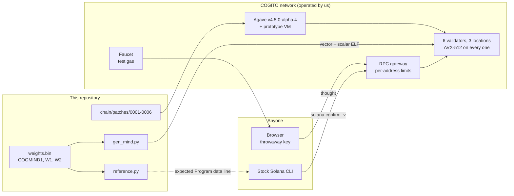
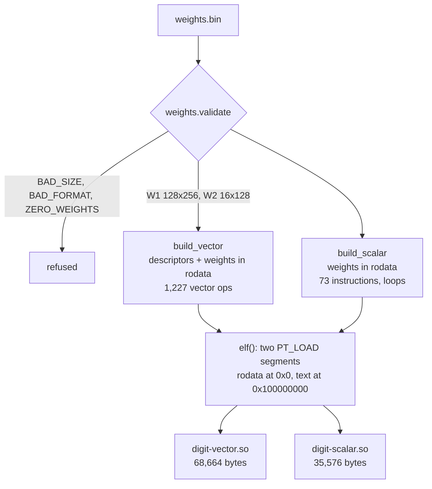
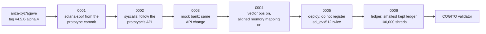

# COGITO

Website [https://cogito.run](https://cogito.run) · X [https://x.com/cogitochain](https://x.com/cogitochain) · GitHub [cogitochain/cogito](https://github.com/cogitochain/cogito) · Whitepaper [docs/whitepaper.md](docs/whitepaper.md)

**A small neural network that runs inside one transaction, on a Solana-compatible chain whose VM has 512-bit vector instructions.**

## Overview

COGITO is a Solana-compatible chain we run ourselves. It is not Solana mainnet: it is Agave `v4.5.0-alpha.4` with six patch files: five replace the SBPF virtual machine with the prototype of the SIMD-0714 draft (temporalxyz/sbpf, commit `585f893`) and switch its vector instructions on, and one lowers the smallest ledger a node may keep, so our nodes hold a short window of history. With them, an Int8 network with 256 inputs, 128 hidden units and 16 outputs answers inside a single transaction for 1,700 CU, where the same network on today's instruction set costs 349,958 CU. SIMD-0714 is a draft and has not been adopted; we are not among its authors. We ran its prototype as it is and measured it.

No key can change a mind once it is on the network. Every mind is deployed final, with no upgrade authority, and its program refuses any account: a thought reads 256 bytes of instruction data and writes one log line, so it has nothing it could move. The network's gas is test gas from a faucet, with no value. Its programs run independently of the $COGITO token.

## How it works

1. **Train.** `chain/minds/digit/train.py` trains the digit mind on MNIST brought to 16 x 16, with the programs' exact integer arithmetic in the forward pass, and writes `weights.bin`.
2. **Pack.** A mind is one 34,824-byte file: the magic `COGMIND1`, then W1 (128 x 256 signed bytes) and W2 (16 x 128), row-major. `weights.py` validates it and refuses a wrong size, a wrong header or an all-zero layer.
3. **Generate.** `gen_mind.py` writes two SBPF v3 ELF files from the same weights: the vector program, where each operation is `lddw r1, <descriptor>` and `call sol_avx512`, and the scalar twin on today's instruction set.
4. **Deploy.** Both programs are deployed final with the fork's own CLI, the only one that can deploy SBPF v3 today. Neither has an upgrade authority.
5. **Think.** A thought is one transaction to a mind with the 256 input bytes as instruction data and no accounts. The program computes h = clamp(relu(W1 x) >> 8, 0, 255) and y = W2 h and logs y as sixteen little-endian i32 values with one `sol_log_data` call.
6. **Check.** `reference.py` recomputes y off chain from the same weights and prints the `Program data:` line the chain must log; the stock Solana CLI shows the real one with `solana confirm -v <signature>` against the network's RPC.

## Architecture

The patches turn upstream Agave into the node every validator runs; the generator turns a weights file into the two programs those validators execute. The reference computation never touches the network: it predicts, byte for byte, what the network will log, so anyone can compare a real transaction's log with it.

One thought is one instruction. A thought with an account or with any length other than 256 bytes ends with a custom error before a single weight is read; the tests run both refusals on the scalar twin.

The generator is deterministic: the same weights give the same bytes. The digit mind's programs built from this repository have the same SHA-256 as the programs deployed on the network, and a test holds them to it.

Each patch is one change to one file, in order, applied with `git apply` by `chain/patches/apply.sh`. Nothing else in Agave changes; the node's fee schedule, consensus and runtime are upstream's, and the vector instructions are priced by the prototype's own CU schedule.

### Programs and accounts

A mind has no state account. Everything it needs is in its own program: the code in the text segment, the weights and the vector descriptors in read-only data.

| Account | Seeds | Holds |
|---|---|---|
| Mind program, vector | none (deployed final) | the vector code, 59 descriptors (944 bytes) and 34,816 weight bytes |
| Mind program, scalar twin | none (deployed final) | the scalar loops and the same 34,816 weight bytes |
| Fee payer of a thought | none | test gas from the faucet; the browser uses a throwaway key |
